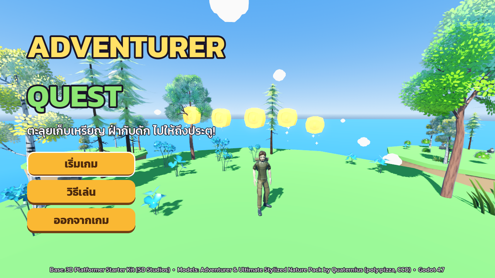
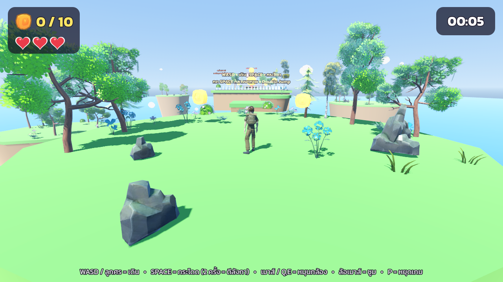
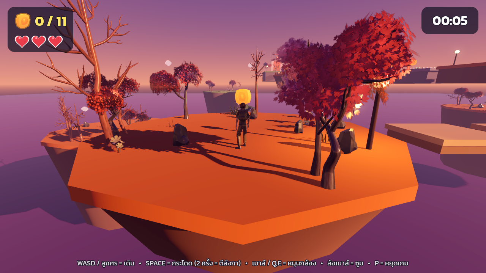
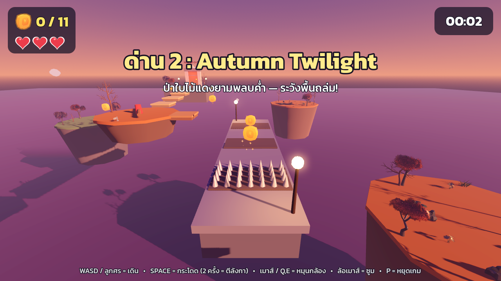

# Game Lab 5: Adventurer Quest

**673380318-3 นายธนดล บุตรคุณ**
วิชา Computer Game Development — วิทยาลัยการคอมพิวเตอร์ มหาวิทยาลัยขอนแก่น

**Play Game:** https://thanadonb-collab.github.io/game5/

## Game Story

นักผจญภัยหนุ่มออกเดินทางตามหาเหรียญทองที่กระจัดกระจายอยู่บนหมู่เกาะลอยฟ้า
เริ่มจากทุ่งหญ้าสดใสยามกลางวัน ไปจนถึงป่าใบไม้แดงยามพลบค่ำ
ต้องฝ่าดงหนามที่โผล่ขึ้นมาตามจังหวะ ท่อนไม้หมุน และพื้นที่พร้อมจะถล่มลงไป
เก็บเหรียญให้ครบเพื่อปลดล็อกประตูหินโบราณที่พาไปยังเกาะถัดไป

*An adventurer hops across floating sky islands to collect scattered gold coins, dodging timed spikes,
spinning logs and crumbling floors to unlock the ancient stone door at the end of each island.*

## Game Style

3D third-person platformer, low-poly floating-islands theme: stylized nature models (trees, rocks, flowers, grass),
procedural sky with two moods (sunny day / autumn twilight with fog), drifting clouds, glowing lanterns and a
Thai-language UI (Kanit font).

## Controls

| Action | Keys |
|---|---|
| Move | W A S D or ← ↑ → ↓ |
| Jump | Space (press again in the air = flip / double jump) |
| Camera | Mouse or Q / E, mouse wheel = zoom |
| Pause | P |
| Release mouse | Esc (click the screen to capture again) |

## Levels (difficulty rises step by step)

| Level | Name | What's new |
|---|---|---|
| 1 | Sunny Meadow | Stepping stones, timed spike field, moving platform, spinning log — 10 coins |
| 2 | Autumn Twilight | Crumbling bridge, double spinner, wooden lift, spike-wave corridor, sliding platform, crumbling stairs — 11 coins |

Each level has flag **checkpoints**, and the exit door stays locked until every coin is collected.

## Features (by assignment requirement)

1. **Player** – Character replaced with *Adventurer* (Quaternius, Poly Pizza); a new AnimationLibrary maps its clips onto the starter kit's set: Idle, Run, Jump (custom leap pose built from Run + Roll), Flip (Roll), plus Hurt, Death and Victory (Wave).
2. **Gameplay** – Dodge traps and obstacles, collect all coins, reach the door to go to the next level.
3. **Traps & level objects** – Timed spike traps, spinning logs (single / double), moving platforms, lifts, crumbling platforms, checkpoints, locked exit door.
4. **Health system** – 3 hearts per level, knockback + temporary invincibility, respawn at the last checkpoint, Game Over screen.
5. **Levels** – 2 hand-designed levels decorated with the *Ultimate Stylized Nature Pack* (Poly Pizza bundle).
6. **UI** – Main menu with 3D scene, how-to-play panel, HUD (coins / hearts / timer), pause menu, victory screen with total coins and time.
7. **Low-poly & small size** – Nature-pack textures reduced to ≤ 512 px and normal maps removed (game data ~9 MB).
8. **Web build** – Exported with the Compatibility renderer to `docs/` and published with GitHub Pages.

## Project

Built with **Godot 4.7.2** from the [3D Platformer Starter Kit](https://store.godotengine.org/asset/the-silver-demons/platformer-3d-starter-kit/)
by SD Studios. The Godot project is in the [`project/`](project/) folder.
Character: Adventurer by Quaternius (Poly Pizza, CC0).
Environment: Ultimate Stylized Nature Pack by Quaternius (Poly Pizza, CC0).
Font: Kanit by Cadson Demak (OFL).
